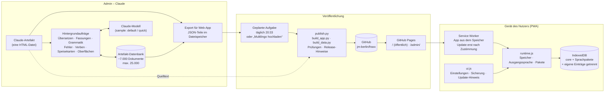
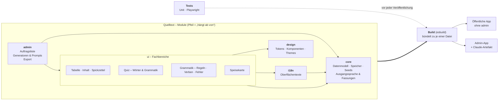

# Multilingo – Plan für die Aufräumphase (nach der Beta)

Vereinbart am 5. November 2026. Bis dahin wird wie bisher in der einen Artefakt-Datei weitergearbeitet,
bis alle Funktionen da sind und das Design geklärt ist. Danach wird auf Basis des Verabschiedeten aufgeräumt.

## Grundsatz
Modular entwickeln, aber weiterhin **eine Datei ausliefern** (narrensichere Installation, komplett austauschbar).
Ein Build-Schritt (z. B. esbuild) bündelt die Module wieder zu je einer HTML-Datei.

## Stand bei der Entscheidung
- Artefakt-Datei ca. 1 MB / 6.600 Zeilen: ~450 KB JavaScript (~260 Funktionen), ~105 KB CSS, eingebettete Bilder, ~33 KB UI-Texte.
- 39 CSS-Regeln mit `html:root:root` zum Überstimmen älterer Schichten.
- Auftragsliste, Warteschlange und Inhalts-Generatoren über gemeinsamen Zustand gekoppelt.
- Keine automatischen Tests (bisher Playwright-Prüfungen von Hand mit simulierten Claude-Antworten).
- Öffentliche Fassung enthält Admin-Code und alle Prompts.

## Systemübersicht heute

Vom Claude-Artefakt (Admin) über die Veröffentlichung bis auf das Gerät des Nutzers.

Bild: [img/systemuebersicht.png](img/systemuebersicht.png)

## Zielarchitektur (Module und Abhängigkeiten)

Pfeil = „hängt ab von“. Gebündelt wird zu je einer Datei: öffentlich ohne admin, Admin mit allem.

Bild: [img/zielarchitektur.png](img/zielarchitektur.png)

## Zielstruktur
- **core**: Datenmodell, Speicher, Seeds, Ausgangssprache/Fassungen
- **ui**: Tabelle, Inhalt, Spickzettel, Quiz, Grammatik, Speisekarte (je ein Modul)
- **i18n**: Oberflächentexte und Übersetzung
- **design**: CSS mit Tokens, Komponenten, Themes – ohne Überstimm-Regeln
- **admin**: Auftragsliste, Generatoren/Prompts, Export
- Zwei Bündel: öffentlich (ohne admin) und Admin (alles; daraus auch das Claude-Artefakt)
- Tests: Unit-Tests für reine Funktionen (Dubletten, Umschrift, Speisekarten-Lücken, Prompt-Bausteine) + Playwright-Rauchtests vor jeder Veröffentlichung

## Reihenfolge (schrittweise, kein Neustart)
1. CSS bereinigen und als Design-System ordnen
2. Admin-Teil herauslösen (öffentlicher Code schlanker, ohne Prompts)
3. Fachbereiche einzeln auslagern, jeweils mit Tests

## Arbeitsweise
Der Admin arbeitet als Nutzer/Product Owner an der Customer Journey; Claude setzt um, testet und veröffentlicht –
wie unter Kollegen, ohne Zeilen-für-Zeilen-Review.

## Modulare Sprachpakete und Bezahlmodell (Idee vom 11.11.2026, noch nicht umgesetzt)

Erst kommt die Testphase mit den vorhandenen Daten (Bedienung, Logik, Oberfläche, Funktionen). Danach wird die Datenstruktur umgebaut.

### Ziel
- **Kostenlos:** eine Ausgangssprache und ein oder zwei Zielsprachen. Die genaue Zahl ist noch offen.
- **Weitere Sprachen:** einzeln gegen Bezahlung.
- **Pro-Paket:** gegen Bezahlung, mit Speisekarten, Zutaten, Grammatik und weiteren Extras (Inhalt noch offen).
- **Ein Konto für alle Geräte:** Handy (Web-App oder Store-App) und PC haben denselben Stand. Am PC ist es übersichtlicher.

### Datenaufteilung (alles über dieselbe Eintrags-ID verknüpft)

| Paket | Inhalt | hängt ab von |
|---|---|---|
| Kern | ID, Bereich/Unterbereich, Wortart, Niveau, Reihenfolge | – (für alle gleich) |
| Sprachpaket *L* | Text in Sprache *L*, Artikel, Konjugation | nur der Sprache |
| Hinweispaket *L*·*S* | Hinweis zum Text in *L*, geschrieben in Ausgangssprache *S* | Ziel- **und** Ausgangssprache |
| Zusatzpakete | Speisekarten/Zutaten je Land, Grammatik je Sprache | Land/Sprache (+ Ausgangssprache für Erklärungen) |

- Ein Sprachpaket dient zugleich als Ausgangs- und als Zielsprache: Die deutsche Spalte ist das deutsche Sprachpaket.
- Hinweispakete sind klein. Bei 12 Sprachen gibt es bis zu 132 Paare, die nur bei Bedarf erzeugt werden.
- Heute steckt das alles in jedem Eintrag. Das macht rund 75 MB in der Datenbank des Artefakts, davon gut 30 MB „Fassungen“ (`nb`/`nbx`). Seit dem 11.11. liegen die Fassungen in `data/users/<id>/nbs/p`. Das ist ein erster Schritt in diese Richtung.
- Wer sich installiert, lädt nur, was er hat: Kern, seine Ausgangssprache, seine Zielsprachen und deren Hinweispakete. Das sind voraussichtlich 10–20 MB statt 100.
- Das Artefakt (Arbeitsfassung des Admins) wird genauso aufgeteilt, damit es nur lädt, was gerade gebraucht wird.

### Bezahlen: was zu klären ist
- **Echte Bezahlschranke:** GitHub Pages liefert jede Datei öffentlich aus. Für bezahlte Pakete braucht es einen kleinen Server mit Konto, Freischaltung und Auslieferung nur nach Prüfung, zum Beispiel Cloudflare Workers + R2 oder Firebase.
- **Zahlungsabwickler für den Verkauf über die Website:** etwa Stripe, Paddle oder Lemon Squeezy. Die beiden Letzteren übernehmen als „Merchant of Record“ auch die Umsatzsteuer in der EU. Das muss der Admin noch auswählen.
- **Konto statt Gerät:** Käufe hängen am Konto, nicht am Gerät (Anmeldung per E-Mail-Link). Das Calimoto-Prinzip: Abo auf der Website abschließen und in jeder App damit anmelden.
- **Store-Apps:** Die Web-App lässt sich verpackt in die Stores bringen. Für Google Play geht das als Trusted Web Activity (z. B. mit PWABuilder oder Bubblewrap), für den App Store mit einer Hülle wie Capacitor oder PWABuilder. Apple verlangt, dass eine App mehr ist als eine verpackte Website (Richtlinie 4.2).
- **Bezahlen in den Stores (Stand Oktober 2026, vor dem Umsetzen bei Apple und Google prüfen):**
  - *Apple:* Digitale Inhalte in der App müssen grundsätzlich über Apples In-App-Kauf laufen.
    - In den USA dürfen Apps seit Mai 2025 auf den Kauf auf der eigenen Website verlinken.
    - In der EU, in Japan und Brasilien geht das nur mit einer besonderen Berechtigung von Apple, und es fällt trotzdem eine Provision an (laut einer Quelle 10–15 %).
    - Im Rest der Welt sind solche Links nicht erlaubt.
    - Wer auf der Website gekauft hat, darf seine Inhalte in der App meist nutzen („Multiplattform“-Regel 3.1.3(b)). Dafür müssen dieselben Inhalte in der App aber auch per In-App-Kauf angeboten werden. Genau prüfen.
  - *Google Play:* Seit Juni 2026 sind in den USA, der EU/EWR und Großbritannien neben Googles Abrechnung auch eigene Abrechnung oder Links zur Website erlaubt. Die Servicegebühr liegt bei 10 % auf die erste Million im Jahr und gilt bei jedem Zahlungsweg. Googles eigene Abrechnung kostet zusätzlich 5 %.
- **Folgerung (vorläufig):** Konto und Käufe zentral auf dem eigenen Server. Verkauft wird auf der Website und zusätzlich per In-App-Kauf in den Store-Apps, wo das verlangt ist. Alle Wege schalten dasselbe Konto frei.
